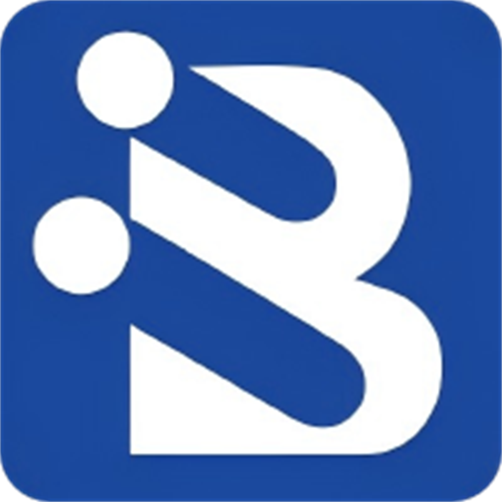
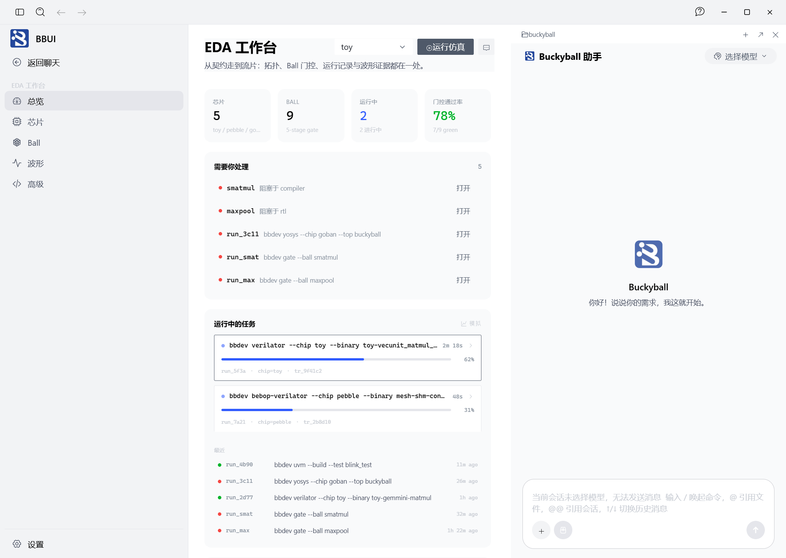
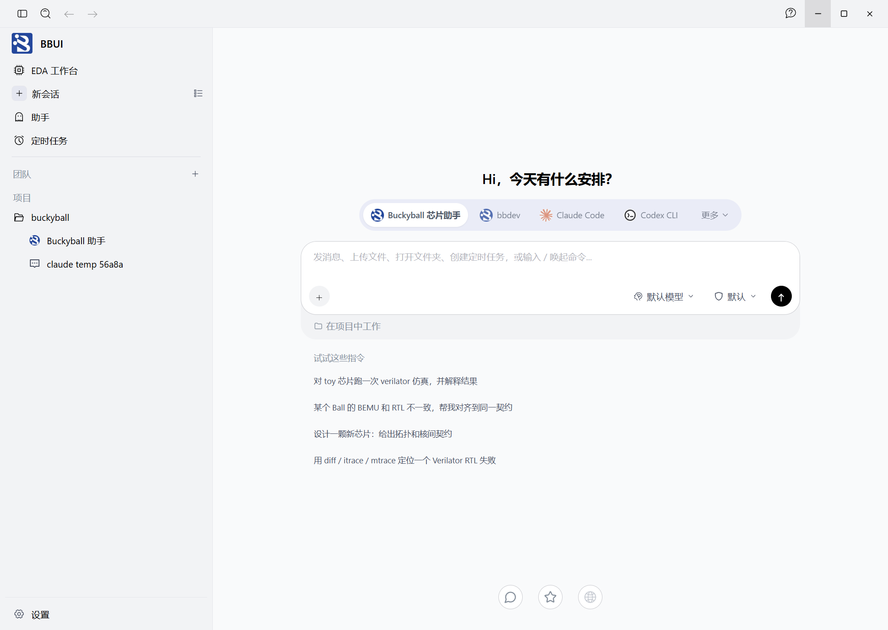
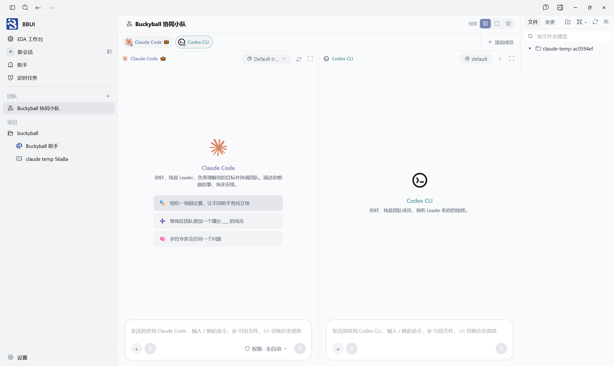
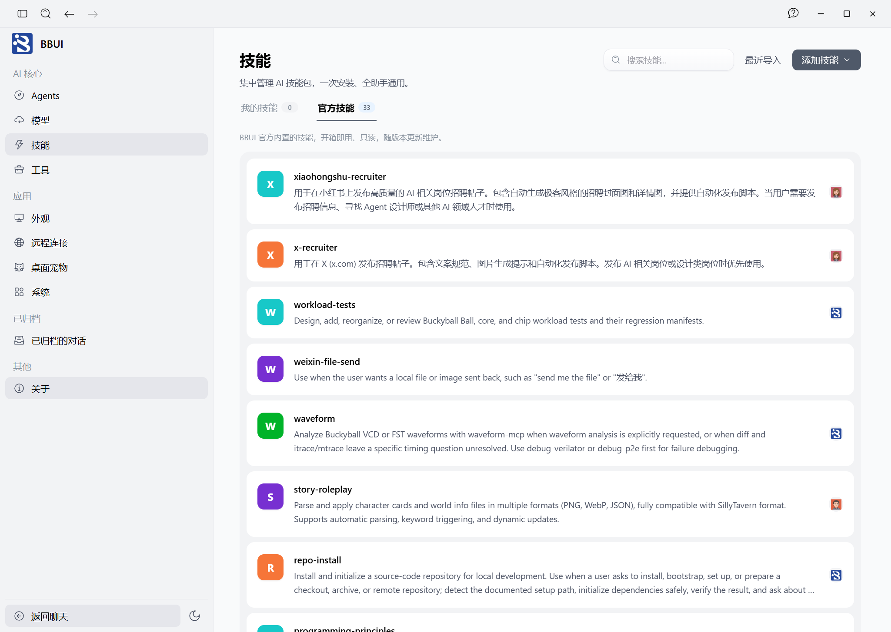
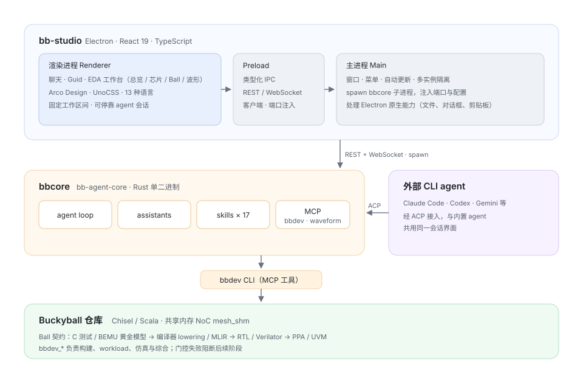

<p align="center">
  
</p>

<h1 align="center">bb-studio</h1>

<p align="center">Buckyball 芯片开发的 AI 桌面工作台</p>

<p align="center">
  <a href="https://github.com/DangoSys/buckyball"></a>
  
  
  
  <a href="LICENSE"></a>
</p>



> EDA 工作台（左）与可停靠的 agent 会话（右）。截图中的数据为演示数据。

## 是什么

[Buckyball](https://github.com/DangoSys/buckyball) 是一个开源的领域专用架构（DSA）框架：加速器周边的共享基础设施——RVV 前端、Ball 契约、存储系统、编译器 lowering、仿真器，以及仿真与验证流程——都由框架提供，加速器开发只专注 DSA 本身。框架用 Chisel/Scala 编写，当前活跃开发的共享内存 NoC 是 `mesh_shm`。

bb-studio 是这个框架的 **AI 工作台**：一个 Electron 桌面壳，把 agent 会话、芯片的 EDA 视图和仿真结果放进同一个窗口。壳本身不含芯片逻辑，也不替你跑构建——它拉起本地 agent runtime（`bbcore`），由 agent 通过 Buckyball 仓库里的 `bbdev_*` MCP 工具完成构建、workload、仿真与综合。

| 组件    | 仓库                                                          | 职责                                                      |
| ------- | ------------------------------------------------------------- | --------------------------------------------------------- |
| 壳      | `bb-studio`（本仓库）                                         | 桌面 UI · chat · EDA 工作台 · ACP host                    |
| runtime | [`bb-agent-core`](https://github.com/imagist13/bb-agent-core) | agent loop · MCP · skills · assistants（`bbcore` 二进制） |

## 界面



**聊天主页**：助手标签、项目工作区间与默认模型都在同一个入口；会话可以绑定 Buckyball 仓库，agent 的文件读写和命令都在那里执行。



**多 agent 协作**：一个团队由 Leader 和若干成员组成，每个成员一列独立会话，可以单独发消息，也可以让 Leader 调度。截图中的成员是本地已安装的 Claude Code 与 Codex CLI。



**设置**：模型、Agents、技能、工具、外观与系统。技能页列出内置技能，其中 `workload-tests`、`waveform`、`repo-install`、`programming-principles` 等来自 Buckyball 助手。

## 与上游 Buckyball 的关系

Buckyball 用三个概念组织一颗芯片：

| 概念     | 含义                                                                                                                                                                                                |
| -------- | --------------------------------------------------------------------------------------------------------------------------------------------------------------------------------------------------- |
| **Ball** | 基本单元：一份横跨 C 测试、BEMU 黄金模型、编译器 lowering 与 MLIR 测试、RTL、UVM 的契约                                                                                                             |
| **Core** | 一个 BallDomain 及其 RTL；`toy` 是新增与实验性 Ball 的维护 core                                                                                                                                     |
| **Chip** | 由 core 组成的拓扑与核间 SharedMem 契约；参考芯片在 [`examples/chips/`](https://github.com/DangoSys/buckyball/tree/main/examples/chips)（`toy`、`pebble`、`goban`、`poly`、`omni`、`multi-rocket`） |

两个仓库分工明确：

| 仓库                    | 角色                                                      |
| ----------------------- | --------------------------------------------------------- |
| **Buckyball**（上游）   | 芯片本体与工具链：C 测试、BEMU、编译器、RTL、`bbdev`、UVM |
| **bb-studio**（本仓库） | 工作台的壳与 agent 侧：会话、技能、MCP 接入、EDA 面板     |

bb-studio 不定义 ISA，也不复刻工具链。它提供的价值在于：agent 的每一次提问、工具调用和仿真结果都落在同一个桌面上，并且始终在 Buckyball 的门控顺序内推进——

```text
C 测试 / BEMU  →  编译器 / MLIR  →  RTL / Verilator  →  PPA / UVM
```

红色阶段阻断后续所有阶段：只修红色阶段及其上游，绝不提前推进。

## 架构



| 层            | 位置                              | 职责                                                                 |
| ------------- | --------------------------------- | -------------------------------------------------------------------- |
| 渲染进程      | `packages/desktop/src/renderer/`  | React 19 + Arco Design + UnoCSS；聊天 / Guid / EDA 工作台；13 种语言 |
| Preload       | `packages/desktop/src/preload/`   | 类型化 IPC，向页面注入后端端口与 REST / WebSocket 客户端             |
| 主进程        | `packages/desktop/src/process/`   | 窗口、菜单、自动更新；启动时 spawn `bbcore` 子进程                   |
| Agent runtime | `bb-agent-core`（`bbcore`，Rust） | agent loop、assistants、17 个技能、MCP、ACP host                     |
| 工具链        | `bbdev` CLI + waveform MCP        | 构建、workload、仿真、综合、波形解析                                 |

一次请求的路径：

1. 壳启动时找到并拉起 `bbcore`，拿到 HTTP 端口；
2. 渲染进程经 preload 的 REST + WebSocket 通道发消息、收流式事件；
3. 每个会话绑定一个固定工作区间（Buckyball 仓库路径），agent 的文件读写与命令都在其中执行；
4. agent 按技能路由调用 MCP 工具，`bbdev_*` 返回 `trace_id`，轮询到终态才算一步完成；
5. 结果回到会话；EDA 面板展示同一份任务状态（当前为演示数据）。

## EDA 工作台

路由 `/eda/:tab?`，五个页签：**总览**、**芯片**、**Ball**、**波形**、**高级**。右侧是可停靠的 agent 会话（桌面 320–640px，窄屏切换为抽屉），每个页签都能把 prompt 连同当前上下文排队给 agent；会话固定使用同一个工作区间。

- 总览：在跑的任务、门控状态、需要你处理的阻塞项、最近的运行记录；
- 芯片 / Ball：拓扑与注册表；
- 波形：波形查看入口；
- 高级：原始配置与运维操作。

模块说明、状态存储与布局不变量见 [pages/eda/README.md](packages/desktop/src/renderer/pages/eda/README.md)。

> 当前数据来自 `mockData.ts`，尚未接入 bbdev trace 与 waveform MCP。

## 现状

分阶段推进（详见 Buckyball 仓库的 `bb-agent-module-plan.md`）：

- ✅ **Phase 0 骨架**：壳启动时 spawn 自建 `bbcore` 二进制，REST + WebSocket 打通。
- ✅ **Phase 1 知识半边**：`buckyball` 助手（中/英规则）+ 17 个 bb 技能 + `bbdev` / `waveform` MCP。
- 🟡 **Phase 2 EDA 工作台**：五页签 + 可停靠会话 + 固定工作区间；数据为演示数据。
- ⏸ **Phase 1 执行半边 / Phase 3**：`bbdev verilator` 仿真闭环、Verilator 日志与断言解析，待 bbdev 工具链（Nix / WSL）就位。

## 已具备的 bb 能力

- **Buckyball 助手**：`buckyball` assistant，内置中/英文领域规则（ball / chip / mesh_shm），默认启用。
- **17 个 bb 技能**：`ball-align` · `check` · `chip-designer` · `ip-designer` · `model-port` · `model-optimize` · `debug-compiler` · `debug-bemu` · `debug-verilator` · `debug-p2e` · `debug-performance` · `waveform` · `workload-tests` · `domain-modeling` · `graph-contract` · `programming-principles` · `repo-install`（移植自 `.agents/skills`）。
- **MCP**：`bbdev` + `waveform`（移植自 `.agents/mcps`，运行时注册）。
- **多 agent**：内置 agent 与外部 CLI agent（Claude Code / Codex 等）经 ACP 接入，共用同一套会话界面。

## 目录结构

```text
bb-studio/
├── packages/desktop/
│   ├── src/process/     # Electron 主进程：窗口、后端启动器、服务
│   ├── src/preload/     # 类型化 IPC bridge
│   ├── src/renderer/    # React 界面；pages/eda 为 EDA 工作台
│   └── src/common/      # 主进程与渲染进程共享的类型与配置
├── docs/                # 架构、贡献指南、截图
├── resources/           # 应用图标与打包资源
└── tests/               # Vitest（unit / integration / e2e）
```

## 开发

需要 Node 22–24、[Bun](https://bun.sh)，以及本地的 `bb-agent-core` 源码。壳在启动时会自动 spawn `bb-agent-core` 的 `bbcore` 二进制。

```bash
bun install     # 安装依赖
bun run dev     # 启动开发模式（electron-vite dev）
```

提交前：

```bash
bun run lint        # oxlint
bun run format      # oxfmt
bunx tsc --noEmit   # 类型检查
bun run test        # Vitest
```

打包：`bun run dist:win` / `bun run dist:mac` / `bun run dist:linux`。
更多细节见 [docs/contributing/development.md](docs/contributing/development.md) 与 [CONTRIBUTING.md](CONTRIBUTING.md)。

## License

[Apache-2.0](LICENSE)（沿用上游）。基于 [iOfficeAI/AionUi](https://github.com/iOfficeAI/AionUi) 二次开发；配套 runtime [`bb-agent-core`](https://github.com/imagist13/bb-agent-core) 二次开发自 AionCore。
